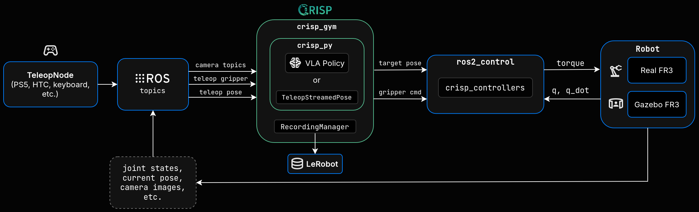

# CRISP Setup

> [!NOTE]
> `crisp_gym` will run inside Pixi environment with dedicated Robostack ROS2 version. Therefore, setup/run crisp outside the Franka Docker environment. CRISP and the Franka Docker ROS will communicate with each other via same `ROS_DOMAIN_ID` and using `rmw_cyclonedds_cpp`.

## Configure the shared Cyclone DDS network interface before entering Pixi

CRISP/Pixi and Docker use the same file: [`../src/cyclonedds.xml`](../src/cyclonedds.xml), relative to this directory. Pixi's activation script sets `CYCLONEDDS_URI` to `file://${PIXI_PROJECT_ROOT}/../src/cyclonedds.xml`. There is no separate Pixi XML file to configure.

**Configure this file before entering `pixi shell`, opening Docker development shells, or launching ROS 2 nodes.** In a host terminal, identify the interface connected to the network shared by the ROS PCs:

```bash
ip -br addr
```

In the repository's `src/cyclonedds.xml` (`../src/cyclonedds.xml` from `crisp/`), set the interface name. For example:

```xml
<NetworkInterface name="eno1"/>
```

Configure each PC's checkout for its own interface. Docker uses host networking, so Docker and Pixi on the same PC use the same interface name.

If you change the configuration after starting ROS, stop the running nodes and run `ros2 daemon stop` in each affected environment. Reopen the Docker/Pixi shells and relaunch the nodes; existing ROS processes do not reload the XML automatically.

## 1. Install Pixi

Linux
```bash
curl -fsSL https://pixi.sh/install.sh | sh
```

## 2. Clone `crisp_gym` 

Navigate to `crisp` directory and clone the `crisp_gym` repository
```bash
cd crisp
git clone git@github.com:learnsyslab/crisp_gym.git
```

## 3. Access Pixi shell and test installation

After configuring the shared Cyclone DDS file above, access the CRISP Pixi shell from `crisp/` with:
```bash
pixi shell -e jazzy-lerobot
```
This will install all the required packages into pixi environment. **Note!: Packages require approx. 13 GB!**

Test that the installation was successful. These should not print anything:
```bash
python -c "import crisp_gym"
python -c "import crisp_py"
```

## 4. Apply `record_functions.py` patch

`patches/` directory contains `record_functions.py` which is modified version from the one that comes with `crisp_gym`. There was a small bug and it has been fixed on that file. Replace `crisp_gym/crisp_gym/record/record_functions.py` with `patches/record_functions.py` file.

Issue was that the original file tried to access `gripper.value` but the `TeleopStreamedPose` class has property `last_gripper`. So I changed `line 78`:
```python
gripper = leader.gripper.value if leader.gripper is not None else 0.0
```
to
```python
gripper = leader.gripper.last_gripper if leader.last_gripper is not None else 0.0
```

## Teleoperation with CRISP


### 2. Copy CRISP env config

Copy configs `franka_fm.yaml`, `franka_fm_no_cameras.yaml` & `franka_fm_real` included in `crisp/src/config/envs` to the `crisp_gym/crisp_gym/config/envs` directory. These are used as config for CRISP environment which handles the robot and gripper control and camera images.

### 3. Run Gazebo or Real Franka ROS2 nodes

If you are testing and want to try this with simulated Franka. Run the Gazebo simulation environment in Docker terminal with:
```bash
ros2 launch franka_fm_gazebo sim.launch.py
```

If you are using real HW/Franka, launch the custom `franka_fm_bringup` package.

- Ensure the robot is connected and ready before launching.
- Verify the correct robot IP and use that.

### Launch with gripper

```bash
ros2 launch franka_fm_bringup franka_fm.launch.py robot_ip:=172.16.0.2 robot_type:=fr3 load_gripper:=true
```

This starts the robot controllers, official Franka Hand action servers, and the CRISP gripper adapter.


### 4. Run PS5/Gamepad teleop node

In Pixi terminal launch new teleop node
```bash
ros2 launch crisp_teleop teleop.launch.py
```

### 5. Run CRISP teleop script

Finally, run script in Pixi/CRISP terminal which is located in `crisp/src/teleop/crisp_teleop.py`. Navigate to that directory in your terminal and run:
```bash
python3 crisp_teleop.py
```

It should print these is everything is OK and then the teleoperation should work:
```
Environment created
Target initialized
Teleop is ready
```

## 6. Record LeRobot data

### 1. In Docker terminal, run Gazebo or Real HW bringup as instructed above to start required Franka ROS2 nodes

### 2. Launch PS5/Gamepad teleop node in Pixi terminal
```bash
ros2 launch crisp_teleop teleop.launch.py
```

### 3. In another Pixi terminal navigate to `crisp/src/record` directory and run `record_teleop.py`

Script accepts multiple arguments but here is one example for testing

```bash
python3 record_teleop.py --tasks 'Pick the green cube and place it on the blue surface' --fps 30 --num-episodes 2 
```
By running that, the script should initialize the recording and waits until user presses `r` to start the teleop and recording. By pressing `r` again, it asks whether
the user wants to save/delete the recorded episode by pressing `s`/`d`. Press `s` and the episode should be saved. 

Script saves the episode(s) automatically into `/home/<username>/.cache/huggingface/lerobot/test` directory. 

If you want to record episodes and push them into hugging face you must give arguments `--repo-id <username>/<repo-id>` and `--push-to-hub true`. However, that is not mandatory
since the episodes can be saved locally and pushed into hugging face hub afterwards.

## 7. Hugging Face hub CLI configuration

### 1. Install hf CLI with:

```
curl -LsSf https://hf.co/cli/install.sh | bash
```

### 2. Login / Create Access Token

Login to [Hugging Face](https://huggingface.co)

Login from terminal:
```bash
hf auth login
```
That will prompt whether you want to login traditionally with browser or use access token.

If you want to use access token: Go to Settings > Access Token and create new access token and copy the value and paste the token value when prompted in terminal.

## 8. Push datasets manually into HF hub

### 1. Create dataset repo to HF hub

### 2. Copy dataset (optional)
Once you have successfully recorded dataset and setup the hf CLI authentication, you can copy the data set from `/home/<username>/.cache/huggingface/lerobot` to e.g. `/home/<username>`

### 3. Push data to HF repo

From the dataset directory:
```bash
hf upload <username>/<repo-id> . --repo-type=dataset
```
### Example dataset

An example dataset recorded with this setup can be found from [fr3-gz](https://huggingface.co/datasets/iikkao/fr3-gz)

# Inference with CRISP

### 1. Download the fine-tuned model

```bash
pixi run -e jazzy-lerobot hf download otto-95/pi05-fr3-gz 
```

### 2. Set the model directory variable

```bash
MODEL_DIR="$HOME/.cache/huggingface/hub/models--otto-95--pi05-fr3-gz/snapshots/a44cd7d1bceb411108bcceb9ddacf84ea75d0d90"
```

### 3. Start the FR3 simulation

Open a new Docker terminal and launch the gazebo sim:
```bash
ros2 launch franka_fm_gazebo sim.launch.py
```

### 4. Deploy policy

Run the following command to deploy the policy:
```bash
pixi run -e jazzy-lerobot python src/scripts/crisp_pi05_control.py \
    --repo-id <username>/<dataset_name> \
    --robot-type franka_fm \
    --path "$MODEL_DIR" \
    --env-namespace "" \
    --env-config franka_fm \
    --recording-manager-type keyboard \
    --fps 30 \
    --no-push-to-hub \
    --policy-config 0_default_config 
```
When the policy is ready, you can start the policy by pressing `r`. The policy is recorded locally to the specified `repo-id`. 

If you encounter an error similar to: 
```bash
Timed out waiting for controllers: ['cartesian_impedance_controller']. Available controllers:  ['twist_broadcaster', '', '', '', '', ''] 
```
You have to relaunch the gazebo simulation and then rerun the deploy command. You may have to repeat this multiple times. 

There is a bug, where only one controller is available inside the pixi env instead of all six. You can check which controller is available using command: 
```bash
ros2 control list_controllers
```
The deploy policy script works when `cartesian_impedance_controller` is available.

# Training with CRISP

### 1. Download the dataset
```bash
pixi run -e jazzy-lerobot hf download iikkao/fr3-gz --repo-type dataset
```

### 2. Set the dataset path
```bash
DATASET="$HOME/.cache/huggingface/hub/datasets--iikkao--fr3-gz/snapshots/efc5ef177a2fa4c341e6d17aebf1f9c7c5d4962a"
```

### 3. Convert the dataset from v2.1 to v3.0
```bash
 pixi run -e jazzy-lerobot python -m lerobot.datasets.v30.convert_dataset_v21_to_v30 \
  --repo-id=iikkao/fr3-gz \
  --root="$DATASET" \
  --push-to-hub=false
```
### 4. Update the dataset path
```bash
DATASET="$DATASET/iikkao/fr3-gz"
```

### 5. Calculate the quantile stats
```bash
pixi run -e jazzy-lerobot python \
  .pixi/envs/jazzy-lerobot/lib/python3.11/site-packages/lerobot/datasets/v30/augment_dataset_quantile_stats.py \
  --repo-id=iikkao/fr3-gz \
  --root="$DATASET" \
  --push-to-hub=false
```

### 6. Edit postprocessor.json and preprocessor.json
Remove the `relative_actions_processor` field from both postprocessor.json and preprocessor.json files. The files are located in `$HOME/.cache/huggingface/hub/models--lerobot--pi05_droid/snapshots/72824c0a93f00ce5bb8bedb7feb58953ba1da364`


### 7. Start the training 

```bash
pixi run -e jazzy-lerobot lerobot-train \
  --dataset.repo_id=iikkao/fr3-gz \
  --dataset.root="$DATASET" \
  --policy.type=pi05 \
  --policy.pretrained_path=lerobot/pi05_droid \
  --policy.chunk_size=50 \
  --policy.n_action_steps=50 \
  --optimizer.lr=3.5e-5 \
  --optimizer.weight_decay=0.01 \
  --optimizer.grad_clip_norm=1.0 \
  --output_dir="$HOME/outputs/pi05_fr3" \
  --job_name=pi05_fr3 \
  --batch_size=16 \
  --num_workers=4 \
  --steps=1000 \
  --save_freq=500 \
  --log_freq=100 \
  --policy.push_to_hub=false
```

# Architecture idea:

