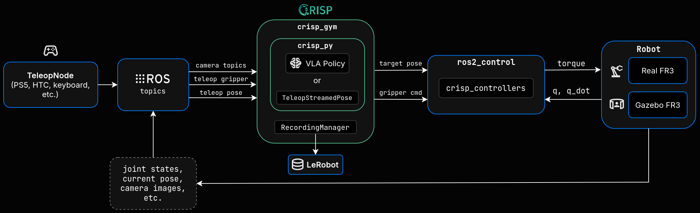

# CRISP upload, inference, and training

Complete the [Pixi setup](../README.md) first. Run the host commands below from the repository’s `crisp/` directory. Example snapshot paths must match the files downloaded on your PC. For real-hardware recording, use the [root workflow](../../README.md#dataset-recording-workflow-with-real-hw).

## Hugging Face CLI setup

### 1. Install hf CLI with:

```
curl -LsSf https://hf.co/cli/install.sh | bash
```

### 2. Login / Create Access Token

Login to [Hugging Face](https://huggingface.co)

Login from terminal:
```bash
hf auth login
```
That will prompt whether you want to login traditionally with browser or use access token.

If you want to use access token: Go to Settings > Access Token and create new access token and copy the value and paste the token value when prompted in terminal.

## Upload a dataset

### 1. Create dataset repo to HF hub

### 2. Copy dataset (optional)
Once you have successfully recorded dataset and setup the hf CLI authentication, you can copy the data set from `/home/<username>/.cache/huggingface/lerobot` to e.g. `/home/<username>`

### 3. Push data to HF repo

From the dataset directory:
```bash
hf upload <username>/<repo-id> . --repo-type=dataset
```
### Example dataset

An example dataset recorded with this setup can be found from [fr3-gz](https://huggingface.co/datasets/iikkao/fr3-gz)

## Inference with CRISP

### 1. Download the fine-tuned model

```bash
pixi run -e jazzy-lerobot hf download otto-95/pi05-fr3-gz
```

### 2. Set the model directory variable

```bash
MODEL_DIR="$HOME/.cache/huggingface/hub/models--otto-95--pi05-fr3-gz/snapshots/a44cd7d1bceb411108bcceb9ddacf84ea75d0d90"
```

### 3. Start the FR3 simulation

Start the simulation using the [root README instructions](../../README.md#launch-gazebo--rviz).

### 4. Deploy policy

Run the following command to deploy the policy:
```bash
pixi run -e jazzy-lerobot python src/scripts/crisp_pi05_control.py \
    --repo-id <username>/<dataset_name> \
    --robot-type franka_fm \
    --path "$MODEL_DIR" \
    --env-namespace "" \
    --env-config franka_fm \
    --recording-manager-type keyboard \
    --fps 30 \
    --no-push-to-hub \
    --policy-config 0_default_config
```
When the policy is ready, you can start the policy by pressing `r`. The policy is recorded locally to the specified `repo-id`.

If you encounter an error similar to:
```bash
Timed out waiting for controllers: ['cartesian_impedance_controller']. Available controllers:  ['twist_broadcaster', '', '', '', '', '']
```
You have to relaunch the gazebo simulation and then rerun the deploy command. You may have to repeat this multiple times.

There is a bug, where only one controller is available inside the pixi env instead of all six. You can check which controller is available using command:
```bash
ros2 control list_controllers
```
The deploy policy script works when `cartesian_impedance_controller` is available.

## Training with CRISP

### 1. Download the dataset
```bash
pixi run -e jazzy-lerobot hf download iikkao/fr3-gz --repo-type dataset
```

### 2. Set the dataset path
```bash
DATASET="$HOME/.cache/huggingface/hub/datasets--iikkao--fr3-gz/snapshots/efc5ef177a2fa4c341e6d17aebf1f9c7c5d4962a"
```

### 3. Convert the dataset from v2.1 to v3.0
```bash
 pixi run -e jazzy-lerobot python -m lerobot.datasets.v30.convert_dataset_v21_to_v30 \
  --repo-id=iikkao/fr3-gz \
  --root="$DATASET" \
  --push-to-hub=false
```
### 4. Update the dataset path
```bash
DATASET="$DATASET/iikkao/fr3-gz"
```

### 5. Calculate the quantile stats
```bash
pixi run -e jazzy-lerobot python \
  .pixi/envs/jazzy-lerobot/lib/python3.11/site-packages/lerobot/datasets/v30/augment_dataset_quantile_stats.py \
  --repo-id=iikkao/fr3-gz \
  --root="$DATASET" \
  --push-to-hub=false
```

### 6. Edit postprocessor.json and preprocessor.json
Remove the `relative_actions_processor` field from both postprocessor.json and preprocessor.json files. The files are located in `$HOME/.cache/huggingface/hub/models--lerobot--pi05_droid/snapshots/72824c0a93f00ce5bb8bedb7feb58953ba1da364`


### 7. Start the training

```bash
pixi run -e jazzy-lerobot lerobot-train \
  --dataset.repo_id=iikkao/fr3-gz \
  --dataset.root="$DATASET" \
  --policy.type=pi05 \
  --policy.pretrained_path=lerobot/pi05_droid \
  --policy.chunk_size=50 \
  --policy.n_action_steps=50 \
  --optimizer.lr=3.5e-5 \
  --optimizer.weight_decay=0.01 \
  --optimizer.grad_clip_norm=1.0 \
  --output_dir="$HOME/outputs/pi05_fr3" \
  --job_name=pi05_fr3 \
  --batch_size=16 \
  --num_workers=4 \
  --steps=1000 \
  --save_freq=500 \
  --log_freq=100 \
  --policy.push_to_hub=false
```

## Architecture

